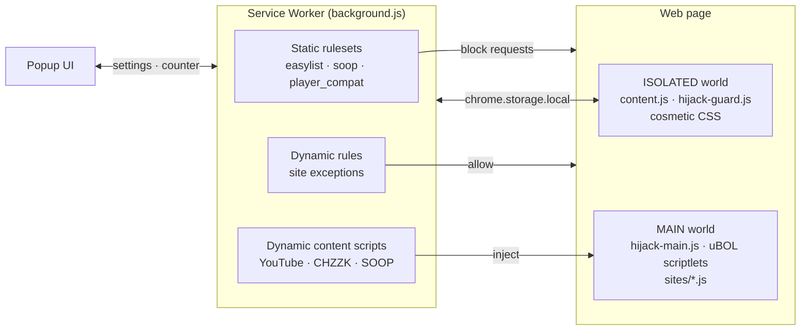

<div align="center">


# Lightweight Ad Blocker

**Fast and quiet.** A Manifest V3 ad blocker tuned for the Korean web.


[한국어](README.md) | **English** | [简体中文](README.zh-CN.md)

</div>

---

An ad blocker that runs on Chrome's official `declarativeNetRequest` API and local content scripts. Nothing else is needed.
There is no external server, no remote rule download, and no build tool. Load the folder and it works.

Generic filter lists miss a lot on Korean sites such as **YouTube, CHZZK, SOOP and FM Korea**. This extension adds handling built from analyzing each of those sites.
Each piece is kept narrow so it only acts where its behavior was actually verified.

> The extension's UI is in Korean. This document gives the Korean label next to each control.

## ✨ Features

| | Feature | Description |
|---|---|---|
| 🛡️ | **Network blocking** | **56,058** static DNR rules based on KoreanList+EasyList |
| 🧹 | **Element hiding** | **13,360** generic CSS selectors and **16,701** domain-specific selectors, matched against each site's exceptions |
| ▶️ | **YouTube** | Player, in-feed and Shorts ads handled by the official uBlock Origin Lite scriptlet bundle, used unmodified |
| 📺 | **CHZZK** | Plays public live streams in high quality over HLS and handles player ad policies |
| 🎈 | **SOOP** | 9 supplemental rules from List-KR, plus removal of VOD "AdBalloon" banners |
| 🪤 | **Click-hijack protection** | Blocks transparent overlays on videos, ad-link redirects and unwanted popups |
| 🔢 | **Block counter** | Shows how many requests were blocked in the current tab, on the icon badge and in the popup |
| 🔒 | **Local only** | Settings live only in the browser's local storage and are never sent anywhere |

## 🚀 Installation

> The extension is not on the Chrome Web Store yet. Load it manually in developer mode.

1. Clone the repository.
   ```bash
   git clone https://github.com/buriburi110/adblock.git
   ```
2. Open `chrome://extensions` in Chrome.
3. Turn on **Developer mode** in the top-right corner.
4. Click **Load unpacked** and select the `adblock/adblock` folder (the one containing `manifest.json`).
5. Pin **가벼운 광고 차단기** (Lightweight Ad Blocker) from the puzzle icon in the toolbar.
6. Reload any tabs that were already open.

**To update:** `git pull` → click 🔄 reload on the extension card → reload open pages

## 🎛️ Usage

Click the toolbar icon to open the popup.

| Switch | Scope | What it does |
|---|---|---|
| **광고 차단** (Ad blocking) | Global | Turns the whole extension on or off |
| **이 사이트에서 차단** (Block on this site) | Current host | When off, disables both ad blocking and hijack protection on this site |
| **클릭 납치 방지** (Click-hijack protection) | Current host | Toggles hijack protection only, leaving other ad filters in place |
| └ Strict mode | Current host | Also blocks external popups whose destination differs from the link you clicked. Login and payment popups may be blocked too, so it is off by default |
| └ Allow on this page / Restore protection | Current document | Temporarily turns protection off or back on. Reloading restores the default |

Site exceptions are stored as high-priority dynamic `allowAllRequests` rules and survive browser restarts.

## 🌐 Site-specific support

| Site | What it does | Details |
|---|---|---|
| **YouTube** | Runs uBOL `2026.729.1529` scriptlets in the MAIN and ISOLATED worlds. Handles ad fields in player responses and server-side playback restrictions, and hides in-feed, Shorts and overlay ads | [Vendor notice](adblock/vendor/ublock-origin-lite/NOTICE.md) |
| **CHZZK** | Connects high-quality playback using the HTTPS HLS URLs the site already provides. Handles ad policies and the Naver SSP video ad list | [Research notes](adblock/docs/CHZZK_RESEARCH.md) |
| **SOOP** | Blocks ad config, recommendation and creative requests, and removes only the `adballoon` field from VOD responses | [Research notes](adblock/docs/SOOP_RESEARCH.md) |
| **FM Korea** | Site-specific CSS for ad containers that public lists do not hide | `sites/fmkorea.css` |
| **sexkbj.tv** | Hides verified affiliate ad banners and adds blocking for the video ad API | [Research notes](adblock/docs/SEXKBJ_RESEARCH.md) |
| **04.avsee.is** | A compatibility rule that blocks only one specific version of an ad-check script | `rules/player-compat.json` |

> Login, age checks, purchases, playback rights, video URLs and tokens are **never modified on any site.**

## 🏗️ How it works



- **Network layer:** Chrome evaluates the rules itself. The extension's code never sees request contents.
- **Cosmetic layer:** selectors that have no exceptions ship as static CSS. Conditional selectors are inserted only when the current host needs them.
- **Site layer:** registered only on verified hosts. Per-site off states are applied through `excludeMatches`.

### Design principles

- **Block narrowly.** Elements are never removed just for being transparent or large. All external links and every `window.open` are never blocked wholesale.
- **Never turn off silently.** Even when YouTube restricts playback, the extension does not quietly allowlist the site or reload the page in a loop.
- **No remote code.** Rules and scriptlets are pinned to reviewed versions in the repository. Updates only happen through explicit scripts.
- **Keep provenance.** Every imported dataset records its upstream version, SHA-256 and conversion stats.

## 🔐 Privacy

- The only permissions are `activeTab`, `declarativeNetRequest`, `scripting` and `storage`.
- Cookies, video URLs, click destinations, DOM text and browsing history are never stored or sent anywhere.
- Block reasons and counters (capped at 999) live only in per-document memory and disappear when the page closes.
- Only in strict mode is a URL held briefly in memory (500 ms), to compare a link's destination with a popup's.

## 🧪 Testing

Offline checks need only Node.js. Run them from the `adblock/adblock` folder.

```bash
node scripts/validate.mjs          # static checks: manifest, rules, hashes
node scripts/smoke-tests.mjs       # settings and toggle logic
node scripts/hijack-tests.mjs      # click-hijack protection
node scripts/overlay-tests.mjs     # click overlays
node scripts/soop-tests.mjs        # SOOP
node scripts/chzzk-tests.mjs       # CHZZK
node scripts/sexkbj-tests.mjs
node scripts/player-compat-tests.mjs
```

With [Playwright](https://playwright.dev/) and its Chromium build (`npx playwright install chromium`), you can load the extension into a real browser and test it there.
The tests run in a separate temporary profile, so your everyday Chrome profile is not touched.

```bash
node scripts/chrome-load-check.mjs
node scripts/hijack-tests.mjs --chrome
node scripts/soop-tests.mjs --chrome
node scripts/chzzk-tests.mjs --chrome
```

There are also optional diagnostics that visit the live sites (`soop-live-check.mjs`, `chzzk-live-check.mjs`). These use the external network.

## 📁 Project structure

```text
adblock/
├── manifest.json           extension config and permissions
├── background.js           syncs rulesets, site exceptions and dynamic scripts
├── content.js              turns element hiding on and off
├── hijack-*.js             click-hijack protection (classifier · ISOLATED · MAIN)
├── cosmetic.css            conservative ad element selectors
├── youtube*.{js,css}       YouTube-specific handling
├── sites/                  code for CHZZK, SOOP, FM Korea and other sites
├── rules/                  DNR rulesets, cosmetic index, source notices
├── vendor/ublock-origin-lite/  pinned uBOL scriptlet bundle
├── popup/                  toolbar popup UI
├── scripts/                validation, test and filter import tools
└── docs/                   per-site research notes (Korean)
```

## 🔄 Updating filters

Rules are not updated automatically. Review a new version first, then import it yourself.

```bash
# Rebuild the KoreanList+EasyList snapshot from an installed AdBlock extension
node scripts/import-installed-easylist.mjs

# Import YouTube scriptlets from an unpacked official uBOL Chromium release
node scripts/import-ubol-youtube.mjs /path/to/uBOLite-release
```

## ⚠️ Known limitations

- Extended selectors (`#?#`), procedural selectors and generic scriptlets are not supported on general sites yet.
- Click-hijack protection is not guaranteed to stop every case. Known gaps: pages that assign `location` directly, a `window.open` reference saved in advance, closed Shadow DOM, and destinations not yet on the list.
- Ad delivery varies by account, region and time. A short passing test does not mean every mid-roll ad is blocked.
- After updating the extension, reload any open tabs to pick up the new code.

## 📜 Changelog

| Version | Changes |
|---|---|
| **1.10.0** | Click-hijack protection: overlay, link and popup protection, strict mode, per-page allow and restore |
| 1.9.5 | Compatibility rule for a specific player's ad-check script |
| 1.9.4 | Hide `div[data-cl-overlay]` click overlays |
| 1.9.1 – 1.9.3 | Follow-up CHZZK ad handling, better diagnostics, more video servers |
| 1.9 | Restore high-quality CHZZK live playback |
| 1.8 – 1.8.1 | SOOP VOD support, more site fixes |
| 1.7 | Switch YouTube to the official uBOL scriptlet bundle |

The detailed per-version history (in Korean) is in [`adblock/README.md`](adblock/README.md).

## 🙏 Credits & license

This project is released under the [GNU GPL v3](adblock/LICENSE.txt). It uses data and code from these open-source projects:

| Project | What is used | License |
|---|---|---|
| [EasyList](https://easylist.to/) / KoreanList | Network and cosmetic rules, 10 popup patterns | CC BY-SA 3.0+ / GPL-3.0+ · [notice](adblock/rules/EASYLIST_NOTICE.md) |
| [uBlock Origin Lite](https://github.com/uBlockOrigin/uBOL-home) | YouTube scriptlet bundle (unmodified) | GPL-3.0-or-later · [notice](adblock/vendor/ublock-origin-lite/NOTICE.md) |
| [List-KR](https://github.com/List-KR/List-KR) | 9 SOOP rules + 1 scriptlet | GPL-3.0 · [notice](adblock/rules/SOOP_NOTICE.md) |

Ad blocking may conflict with some sites' terms of service. You use it at your own risk.
Consider allowlisting the creators and sites you want to support. 💙
