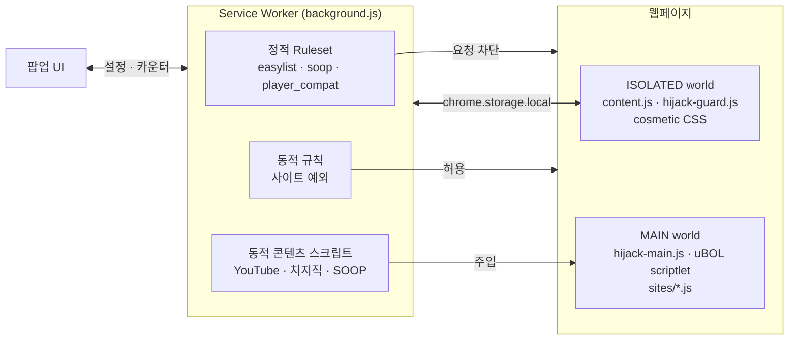

<div align="center">


# 가벼운 광고 차단기

**빠르고 조용하게.** 한국 웹에 맞춘 Manifest V3 광고 차단 확장 프로그램


</div>

---

Chrome의 공식 `declarativeNetRequest` API와 로컬 콘텐츠 스크립트만으로 동작하는 광고 차단기입니다.
외부 서버, 원격 규칙 다운로드, 빌드 도구가 없습니다. 폴더를 불러오면 바로 쓸 수 있습니다.

범용 필터 목록이 놓치는 **YouTube · 치지직 · SOOP · FM코리아** 같은 국내 사이트를 위해 따로 분석한 처리를 더했습니다.
각 처리는 실제로 확인한 범위에서만 동작하도록 좁게 만들었습니다.

## ✨ 주요 기능

| | 기능 | 설명 |
|---|---|---|
| 🛡️ | **네트워크 차단** | KoreanList+EasyList 기반 정적 DNR 규칙 **56,058개** |
| 🧹 | **광고 영역 숨김** | 범용 CSS 선택자 **13,360개**와 도메인별 선택자 **16,701개**를 사이트 예외와 대조해 적용 |
| ▶️ | **YouTube** | 공식 uBlock Origin Lite scriptlet 번들(수정 없음)로 플레이어·인피드·Shorts 광고 처리 |
| 📺 | **치지직** | 공개 라이브를 고화질 HLS로 재생하고 플레이어 광고 정책 처리 |
| 🎈 | **SOOP** | List-KR 기반 보조 규칙 9개, VOD 애드벌룬 배너 제거 |
| 🪤 | **클릭 납치 방지** | 영상 위 투명 덮개, 광고 링크 이동, 원치 않는 팝업 차단 |
| 🔢 | **차단 카운터** | 현재 탭에서 차단한 요청 수를 아이콘 배지와 팝업에 표시 |
| 🔒 | **로컬 전용** | 설정은 브라우저 로컬 저장소에만 저장하며 외부로 보내지 않음 |

## 🚀 설치

> 아직 Chrome 웹 스토어에 올라가 있지 않습니다. 개발자 모드로 직접 불러와야 합니다.

1. 저장소를 내려받습니다.
   ```bash
   git clone https://github.com/buriburi110/adblock.git
   ```
2. Chrome 주소창에 `chrome://extensions`를 입력합니다.
3. 오른쪽 위의 **개발자 모드**를 켭니다.
4. **압축해제된 확장 프로그램을 로드합니다**를 누르고 `adblock/adblock` 폴더(`manifest.json`이 있는 곳)를 고릅니다.
5. 툴바 퍼즐 아이콘에서 **가벼운 광고 차단기**를 고정합니다.
6. 이미 열려 있던 탭은 새로고침합니다.

**업데이트할 때:** `git pull` → 확장 카드의 🔄 새로고침 → 열려 있던 페이지 새로고침

## 🎛️ 사용법

툴바 아이콘을 누르면 팝업이 열립니다.

| 스위치 | 범위 | 동작 |
|---|---|---|
| **광고 차단** | 전체 | 확장 전체를 켜거나 끕니다 |
| **이 사이트에서 차단** | 현재 호스트 | 끄면 이 사이트에서 광고 차단과 납치 방지를 모두 해제합니다 |
| **클릭 납치 방지** | 현재 호스트 | 다른 광고 필터는 두고 납치 방지만 켜거나 끕니다 |
| └ 강화 모드 | 현재 호스트 | 직접 누른 링크와 목적지가 다른 외부 팝업까지 막습니다. 로그인·결제 팝업도 막힐 수 있어 기본값은 꺼짐입니다 |
| └ 이번 페이지에서 허용 / 보호 복구 | 현재 문서 | 보호를 잠시 끄거나 다시 켭니다. 새로고침하면 기본값으로 돌아갑니다 |

사이트 예외는 높은 우선순위의 동적 `allowAllRequests` 규칙으로 저장되며, 브라우저를 다시 시작해도 유지됩니다.

## 🌐 사이트별 지원

| 사이트 | 처리 내용 | 상세 |
|---|---|---|
| **YouTube** | uBOL `2026.729.1529` scriptlet을 MAIN·ISOLATED world에서 실행합니다. player 응답의 광고 필드와 서버 측 재생 제한을 처리하고, 인피드·Shorts·오버레이 광고를 숨깁니다 | [vendor 고지](adblock/vendor/ublock-origin-lite/NOTICE.md) |
| **치지직** | 사이트가 이미 주는 HTTPS HLS 주소로 고화질 재생을 연결합니다. 광고 정책과 Naver SSP 영상 광고 목록을 처리합니다 | [연구 기록](adblock/docs/CHZZK_RESEARCH.md) |
| **SOOP** | 광고 설정·추천·소재 요청을 차단하고 VOD 응답의 `adballoon` 필드만 제거합니다 | [연구 기록](adblock/docs/SOOP_RESEARCH.md) |
| **FM코리아** | 공개 목록으로 숨겨지지 않는 광고 컨테이너를 사이트 전용 CSS로 보완합니다 | `sites/fmkorea.css` |
| **sexkbj.tv** | 확인된 제휴 광고 배너를 숨기고 영상 광고 API 차단을 보완합니다 | [연구 기록](adblock/docs/SEXKBJ_RESEARCH.md) |
| **04.avsee.is** | 특정 버전의 광고 검사 스크립트 하나만 차단하는 호환 규칙입니다 | `rules/player-compat.json` |

> 로그인, 연령, 구매, 재생 권한, 영상 주소와 토큰은 **어떤 사이트에서도 변경하지 않습니다.**

## 🏗️ 동작 방식



- **네트워크 계층**은 Chrome이 규칙을 직접 평가합니다. 확장 코드가 요청 내용을 보지 않습니다.
- **Cosmetic 계층**은 예외와 무관한 선택자를 정적 CSS로 넣고, 조건부 선택자는 현재 호스트에 필요한 것만 넣습니다.
- **사이트 계층**은 확인된 호스트에만 등록하며, 사이트별 OFF 상태를 `excludeMatches`에 반영합니다.

### 설계 원칙

- **좁게 막는다.** 투명도나 큰 면적만 보고 요소를 지우지 않습니다. 모든 외부 링크나 `window.open`을 막지도 않습니다.
- **조용히 끄지 않는다.** YouTube 재생 제한이 생겨도 몰래 자동 허용하거나 페이지를 무한 새로고침하지 않습니다.
- **원격 코드를 실행하지 않는다.** 규칙과 scriptlet은 검토한 버전을 저장소에 고정합니다. 업데이트는 명시적인 스크립트로만 합니다.
- **출처를 남긴다.** 가져온 데이터마다 원본 버전, SHA-256, 변환 통계를 기록합니다.

## 🔐 개인정보

- 추가 권한은 `activeTab`, `declarativeNetRequest`, `scripting`, `storage`뿐입니다.
- 쿠키, 영상 주소, 클릭 목적지, DOM 텍스트, 방문 기록을 저장하거나 외부로 보내지 않습니다.
- 차단 이유와 카운터(최대 999)는 문서별 메모리에만 있다가 페이지를 닫으면 사라집니다.
- 강화 모드에서 링크와 팝업 목적지를 비교할 때만 주소를 메모리에 잠시(500ms) 둡니다.

## 🧪 테스트

Node.js만 있으면 오프라인 검사를 돌릴 수 있습니다. `adblock/adblock` 폴더에서 실행하세요.

```bash
node scripts/validate.mjs          # manifest·규칙·해시 정적 검증
node scripts/smoke-tests.mjs       # 설정·토글 로직
node scripts/hijack-tests.mjs      # 클릭 납치 방지
node scripts/overlay-tests.mjs     # 클릭 덮개
node scripts/soop-tests.mjs        # SOOP
node scripts/chzzk-tests.mjs       # 치지직
node scripts/sexkbj-tests.mjs
node scripts/player-compat-tests.mjs
```

[Playwright](https://playwright.dev/)와 자동화용 Chromium(`npx playwright install chromium`)이 있으면 실제 브라우저에 확장을 불러와 검사할 수 있습니다.
검사는 별도의 임시 프로필에서 실행되므로 평소 쓰는 Chrome 프로필은 건드리지 않습니다.

```bash
node scripts/chrome-load-check.mjs
node scripts/hijack-tests.mjs --chrome
node scripts/soop-tests.mjs --chrome
node scripts/chzzk-tests.mjs --chrome
```

실제 사이트에 접속하는 선택형 진단(`soop-live-check.mjs`, `chzzk-live-check.mjs`)도 있습니다. 이 진단은 외부 네트워크를 사용합니다.

## 📁 프로젝트 구조

```text
adblock/
├── manifest.json           확장 설정과 권한
├── background.js           ruleset·사이트 예외·동적 스크립트 동기화
├── content.js              광고 영역 숨김 ON/OFF 관리
├── hijack-*.js             클릭 납치 방지 (분류기 · ISOLATED · MAIN)
├── cosmetic.css            보수적인 광고 요소 선택자
├── youtube*.{js,css}       YouTube 전용 처리
├── sites/                  치지직 · SOOP · FM코리아 · 기타 사이트 전용 코드
├── rules/                  DNR ruleset, cosmetic 인덱스, 출처 고지
├── vendor/ublock-origin-lite/  고정 버전 uBOL scriptlet 번들
├── popup/                  툴바 팝업 UI
├── scripts/                검증·테스트·필터 가져오기 도구
└── docs/                   사이트별 분석 기록
```

## 🔄 필터 업데이트

규칙은 자동으로 갱신되지 않습니다. 새 버전을 검토한 뒤 직접 가져옵니다.

```bash
# 설치된 AdBlock 확장에서 KoreanList+EasyList snapshot 다시 만들기
node scripts/import-installed-easylist.mjs

# 압축 해제한 uBOL 공식 Chromium 릴리스에서 YouTube scriptlet 가져오기
node scripts/import-ubol-youtube.mjs /path/to/uBOLite-release
```

## ⚠️ 알려진 한계

- 일반 사이트의 확장 선택자(`#?#`), procedural selector, 범용 scriptlet은 아직 지원하지 않습니다.
- 클릭 납치 방지는 다음 경우를 모두 막는다고 보장하지 않습니다: 페이지가 직접 바꾸는 `location`, 미리 저장해 둔 `window.open`, 닫힌 Shadow DOM, 목록에 없는 목적지.
- 광고 송출은 계정, 지역, 시점에 따라 다릅니다. 짧은 검증이 통과했다고 모든 중간광고가 막힌다는 뜻은 아닙니다.
- 확장을 업데이트하면 이미 열려 있는 탭은 새로고침해야 새 코드가 적용됩니다.

## 📜 변경 이력

| 버전 | 내용 |
|---|---|
| **1.10.0** | 클릭 납치 방지: 덮개·링크·팝업 보호, 강화 모드, 페이지별 허용·복구 |
| 1.9.5 | 특정 플레이어 광고 검사 스크립트 호환 규칙 |
| 1.9.4 | `div[data-cl-overlay]` 클릭 덮개 숨김 |
| 1.9.1 – 1.9.3 | 치지직 후속 광고 처리, 진단 보강, 영상 서버 추가 |
| 1.9 | 치지직 라이브 고화질 재생 복구 |
| 1.8 – 1.8.1 | SOOP VOD 대응, 추가 사이트 보완 |
| 1.7 | YouTube를 공식 uBOL scriptlet 번들로 전환 |

버전별 자세한 기록은 [`adblock/README.md`](adblock/README.md)에 있습니다.

## 🙏 크레딧 & 라이선스

이 프로젝트는 [GNU GPL v3](adblock/LICENSE.txt)로 배포합니다. 아래 오픈소스 프로젝트의 데이터와 코드를 사용합니다.

| 프로젝트 | 사용 범위 | 라이선스 |
|---|---|---|
| [EasyList](https://easylist.to/) / KoreanList | 네트워크·cosmetic 규칙, 팝업 패턴 10개 | CC BY-SA 3.0+ / GPL-3.0+ · [고지](adblock/rules/EASYLIST_NOTICE.md) |
| [uBlock Origin Lite](https://github.com/uBlockOrigin/uBOL-home) | YouTube scriptlet 번들 (수정 없음) | GPL-3.0-or-later · [고지](adblock/vendor/ublock-origin-lite/NOTICE.md) |
| [List-KR](https://github.com/List-KR/List-KR) | SOOP 규칙 9개 + scriptlet 1개 | GPL-3.0 · [고지](adblock/rules/SOOP_NOTICE.md) |

광고 차단은 일부 사이트의 이용약관에 어긋날 수 있습니다. 사용에 따른 책임은 사용자에게 있습니다.
좋아하는 창작자와 사이트는 허용 목록에 넣어 응원해 주세요. 💙
