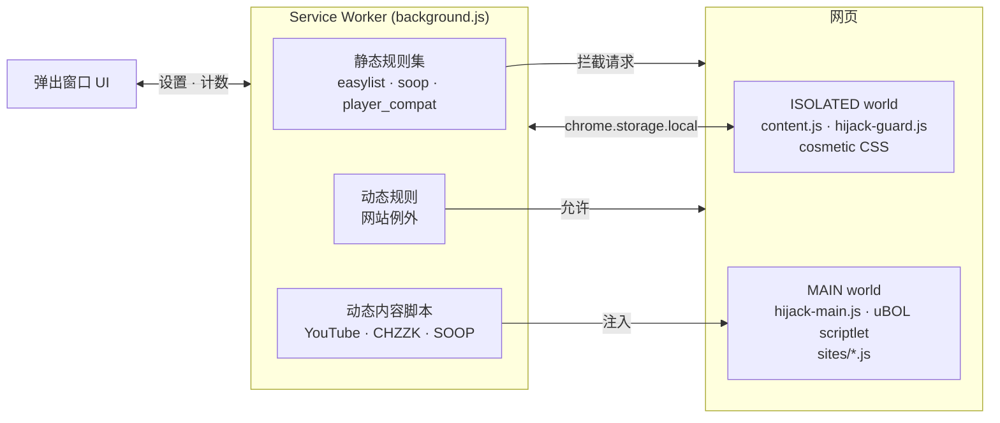

<div align="center">


# 轻量广告拦截器

**快速而安静。** 为韩国网站优化的 Manifest V3 广告拦截扩展


[한국어](README.md) | [English](README.en.md) | **简体中文**

</div>

---

本扩展只使用 Chrome 官方的 `declarativeNetRequest` API 和本地内容脚本来拦截广告。
没有外部服务器，不下载远程规则，也不需要构建工具。加载文件夹即可使用。

通用过滤列表在 **YouTube、CHZZK（치지직）、SOOP、FM Korea** 等韩国网站上会漏掉不少广告。本扩展针对这些网站做了单独分析和处理。
每项处理都刻意收窄范围，只在实际验证过的情况下生效。

> 扩展界面为韩文。本文档在各个开关旁注明了对应的韩文名称。

## ✨ 主要功能

| | 功能 | 说明 |
|---|---|---|
| 🛡️ | **网络拦截** | 基于 KoreanList+EasyList 的静态 DNR 规则 **56,058** 条 |
| 🧹 | **元素隐藏** | **13,360** 条通用 CSS 选择器和 **16,701** 条域名专用选择器，并与各网站的例外规则比对后应用 |
| ▶️ | **YouTube** | 使用官方 uBlock Origin Lite scriptlet 包（未作修改）处理播放器、信息流和 Shorts 广告 |
| 📺 | **CHZZK** | 以高画质 HLS 播放公开直播，并处理播放器广告策略 |
| 🎈 | **SOOP** | 来自 List-KR 的 9 条补充规则，并移除 VOD 中的“AdBalloon”横幅 |
| 🪤 | **防点击劫持** | 拦截视频上的透明遮罩、广告链接跳转和不需要的弹窗 |
| 🔢 | **拦截计数** | 在图标徽标和弹出窗口中显示当前标签页已拦截的请求数 |
| 🔒 | **仅限本地** | 设置只保存在浏览器本地存储中，不会发送到任何地方 |

## 🚀 安装

> 本扩展尚未上架 Chrome 网上应用店，需要在开发者模式下手动加载。

1. 克隆仓库。
   ```bash
   git clone https://github.com/buriburi110/adblock.git
   ```
2. 在 Chrome 地址栏打开 `chrome://extensions`。
3. 打开右上角的 **开发者模式**。
4. 点击 **加载已解压的扩展程序**，选择 `adblock/adblock` 文件夹（即包含 `manifest.json` 的文件夹）。
5. 在工具栏的拼图图标中固定 **가벼운 광고 차단기**（轻量广告拦截器）。
6. 刷新已经打开的标签页。

**更新方法：** `git pull` → 在扩展卡片上点击 🔄 重新加载 → 刷新已打开的页面

## 🎛️ 使用方法

点击工具栏图标即可打开弹出窗口。

| 开关 | 范围 | 作用 |
|---|---|---|
| **광고 차단**（广告拦截） | 全局 | 开启或关闭整个扩展 |
| **이 사이트에서 차단**（在此网站拦截） | 当前主机 | 关闭后，在此网站同时停用广告拦截和防点击劫持 |
| **클릭 납치 방지**（防点击劫持） | 当前主机 | 只开关防点击劫持，其他广告过滤保持不变 |
| └ 强化模式 | 当前主机 | 还会拦截目标与所点击链接不一致的外部弹窗。登录、支付弹窗也可能被拦截，因此默认关闭 |
| └ 本页允许 / 恢复保护 | 当前文档 | 临时关闭或重新开启保护。刷新页面后恢复默认设置 |

网站例外以高优先级的动态 `allowAllRequests` 规则保存，重启浏览器后依然有效。

## 🌐 网站专项支持

| 网站 | 处理内容 | 详情 |
|---|---|---|
| **YouTube** | 在 MAIN 和 ISOLATED world 中运行 uBOL `2026.729.1529` scriptlet。处理播放器响应中的广告字段和服务器端播放限制，并隐藏信息流、Shorts 和覆盖层广告 | [vendor 声明](adblock/vendor/ublock-origin-lite/NOTICE.md) |
| **CHZZK** | 使用网站本身提供的 HTTPS HLS 地址实现高画质播放，并处理广告策略和 Naver SSP 视频广告列表 | [研究记录](adblock/docs/CHZZK_RESEARCH.md) |
| **SOOP** | 拦截广告配置、推荐和素材请求，并只移除 VOD 响应中的 `adballoon` 字段 | [研究记录](adblock/docs/SOOP_RESEARCH.md) |
| **FM Korea** | 用网站专用 CSS 隐藏公开列表无法隐藏的广告容器 | `sites/fmkorea.css` |
| **sexkbj.tv** | 隐藏已确认的联盟广告横幅，并补充拦截视频广告 API | [研究记录](adblock/docs/SEXKBJ_RESEARCH.md) |
| **04.avsee.is** | 只拦截某一特定版本广告检测脚本的兼容规则 | `rules/player-compat.json` |

> 在**任何网站上都不会修改**登录、年龄验证、购买、播放权限、视频地址和令牌。

## 🏗️ 工作原理



- **网络层：** 由 Chrome 自行评估规则，扩展代码看不到请求内容。
- **Cosmetic 层：** 没有例外的选择器以静态 CSS 注入；条件选择器只在当前主机需要时才注入。
- **网站层：** 只在已验证的主机上注册，各网站的关闭状态通过 `excludeMatches` 生效。

### 设计原则

- **精准拦截。** 不会仅因元素透明或面积大就将其移除，也不会一律拦截所有外部链接或 `window.open`。
- **绝不悄悄关闭。** 即使 YouTube 限制播放，也不会悄悄放行该网站或无限刷新页面。
- **不运行远程代码。** 规则和 scriptlet 都固定为仓库中审核过的版本，只能通过显式脚本更新。
- **保留来源记录。** 每份导入的数据都记录了上游版本、SHA-256 和转换统计。

## 🔐 隐私

- 只申请 `activeTab`、`declarativeNetRequest`、`scripting`、`storage` 四项权限。
- 不会保存或发送 Cookie、视频地址、点击目标、DOM 文本和浏览记录。
- 拦截原因和计数（上限 999）只保存在各文档的内存中，关闭页面后即消失。
- 只有在强化模式下比较链接与弹窗的目标地址时，才会把地址在内存中短暂保留（500 毫秒）。

## 🧪 测试

只需 Node.js 即可运行离线检查。请在 `adblock/adblock` 文件夹中执行。

```bash
node scripts/validate.mjs          # 静态检查：manifest、规则、哈希
node scripts/smoke-tests.mjs       # 设置与开关逻辑
node scripts/hijack-tests.mjs      # 防点击劫持
node scripts/overlay-tests.mjs     # 点击遮罩
node scripts/soop-tests.mjs        # SOOP
node scripts/chzzk-tests.mjs       # CHZZK
node scripts/sexkbj-tests.mjs
node scripts/player-compat-tests.mjs
```

如果装有 [Playwright](https://playwright.dev/) 及其 Chromium（`npx playwright install chromium`），可以把扩展加载到真实浏览器中测试。
测试在单独的临时配置文件中运行，不会影响你平时使用的 Chrome 配置文件。

```bash
node scripts/chrome-load-check.mjs
node scripts/hijack-tests.mjs --chrome
node scripts/soop-tests.mjs --chrome
node scripts/chzzk-tests.mjs --chrome
```

另有访问真实网站的可选诊断（`soop-live-check.mjs`、`chzzk-live-check.mjs`），会使用外部网络。

## 📁 项目结构

```text
adblock/
├── manifest.json           扩展配置与权限
├── background.js           同步规则集、网站例外和动态脚本
├── content.js              管理元素隐藏的开关
├── hijack-*.js             防点击劫持（分类器 · ISOLATED · MAIN）
├── cosmetic.css            保守的广告元素选择器
├── youtube*.{js,css}       YouTube 专项处理
├── sites/                  CHZZK、SOOP、FM Korea 等网站的专用代码
├── rules/                  DNR 规则集、cosmetic 索引、来源声明
├── vendor/ublock-origin-lite/  固定版本的 uBOL scriptlet 包
├── popup/                  工具栏弹出窗口 UI
├── scripts/                验证、测试和过滤器导入工具
└── docs/                   各网站研究记录（韩文）
```

## 🔄 更新过滤器

规则不会自动更新。请先审核新版本，再手动导入。

```bash
# 从已安装的 AdBlock 扩展重新生成 KoreanList+EasyList 快照
node scripts/import-installed-easylist.mjs

# 从解压后的 uBOL 官方 Chromium 发行版导入 YouTube scriptlet
node scripts/import-ubol-youtube.mjs /path/to/uBOLite-release
```

## ⚠️ 已知限制

- 在一般网站上尚不支持扩展选择器（`#?#`）、procedural selector 和通用 scriptlet。
- 防点击劫持不能保证拦截所有情况，已知的漏洞包括：页面直接修改 `location`、预先保存的 `window.open`、封闭的 Shadow DOM，以及尚未列入名单的目标地址。
- 广告投放因账号、地区和时间而异。短时间测试通过，并不代表所有中插广告都能被拦截。
- 更新扩展后，需要刷新已打开的标签页才能使用新代码。

## 📜 更新日志

| 版本 | 内容 |
|---|---|
| **1.10.0** | 防点击劫持：遮罩、链接和弹窗保护，强化模式，按页面允许与恢复 |
| 1.9.5 | 针对特定播放器广告检测脚本的兼容规则 |
| 1.9.4 | 隐藏 `div[data-cl-overlay]` 点击遮罩 |
| 1.9.1 – 1.9.3 | CHZZK 后续广告处理、诊断增强、新增视频服务器 |
| 1.9 | 恢复 CHZZK 直播高画质播放 |
| 1.8 – 1.8.1 | 支持 SOOP VOD，补充更多网站 |
| 1.7 | YouTube 改用官方 uBOL scriptlet 包 |

各版本的详细记录（韩文）见 [`adblock/README.md`](adblock/README.md)。

## 🙏 致谢与许可证

本项目以 [GNU GPL v3](adblock/LICENSE.txt) 发布，并使用了以下开源项目的数据和代码。

| 项目 | 使用范围 | 许可证 |
|---|---|---|
| [EasyList](https://easylist.to/) / KoreanList | 网络与 cosmetic 规则、10 条弹窗规则 | CC BY-SA 3.0+ / GPL-3.0+ · [声明](adblock/rules/EASYLIST_NOTICE.md) |
| [uBlock Origin Lite](https://github.com/uBlockOrigin/uBOL-home) | YouTube scriptlet 包（未作修改） | GPL-3.0-or-later · [声明](adblock/vendor/ublock-origin-lite/NOTICE.md) |
| [List-KR](https://github.com/List-KR/List-KR) | SOOP 规则 9 条 + scriptlet 1 条 | GPL-3.0 · [声明](adblock/rules/SOOP_NOTICE.md) |

广告拦截可能违反部分网站的服务条款，使用风险由用户自行承担。
欢迎把你喜欢的创作者和网站加入允许名单，支持他们。💙
